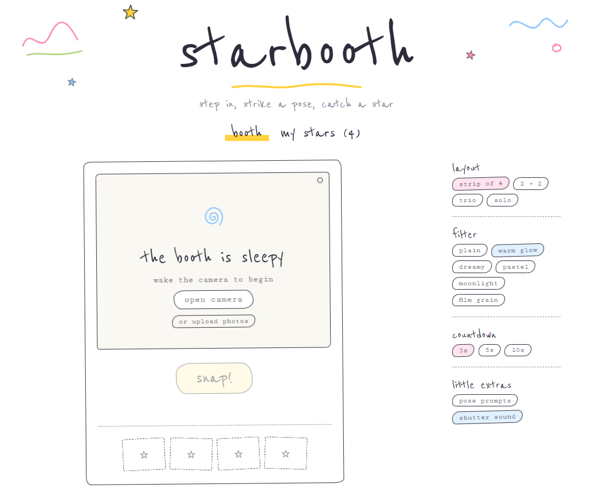

# ✦ starbooth

*step in, strike a pose, catch a star.*

A whimsical little photobooth that runs right in your browser. Take a strip of photos, decorate it
with doodles and keep your favourites. No sign-ups, no uploads, no fuss.

### 👉 [Open Starbooth](https://amymainali.github.io/starbooth/)

## What you can do

- **Take a photostrip:** choose a strip of 4, a 2 × 2 grid, a trio or a solo shot, with a countdown of 3, 5 or 10 seconds
- **Pick a look:** filters like warm glow, dreamy, pastel, moonlight and film grain, plus frames in soft colors, crayon scribbles or a starry night
- **Add some magic:** sparkles, a handwritten caption and draggable doodles such as stars, hearts, swirls, flowers and party hats
- **Get playful:** optional pose prompts, a soft shutter sound, and the spacebar to snap
- **Keep your favourites:** save strips privately in **my stars**, or download them as images

## Your photos stay yours

Everything happens inside your browser. Photos are never uploaded or sent to a server, and there are
no accounts. Strips kept in **my stars** are stored only on your own device, so downloading a strip
is the way to keep it for good.

## Good to know

- Your browser will ask for permission to use the camera the first time. If it's blocked, you can
  upload photos instead.
- Saved strips live in one browser on one device. Clearing your browser's site data will remove them.

## Copyright

© 2026 amymainali. All rights reserved. The code, design and artwork are shared here for viewing
only. Please don't copy, host or redistribute Starbooth, or use it to make your own version,
without written permission. See [LICENSE](LICENSE).

---

Made with a sprinkle of stardust  ݁⋆⭒˚.⋆
